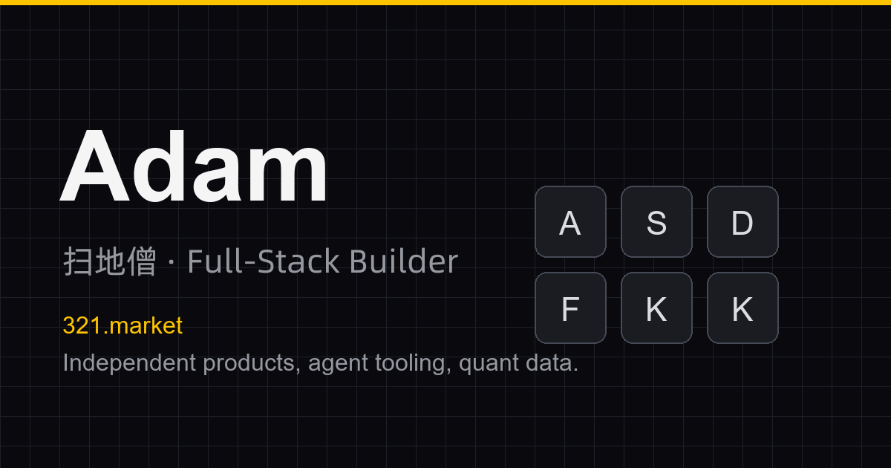
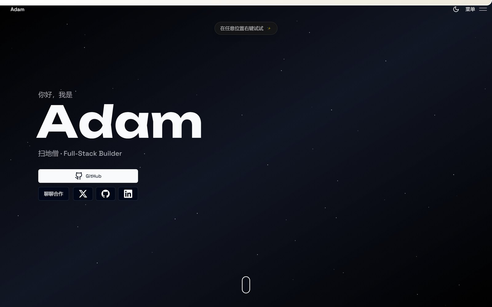
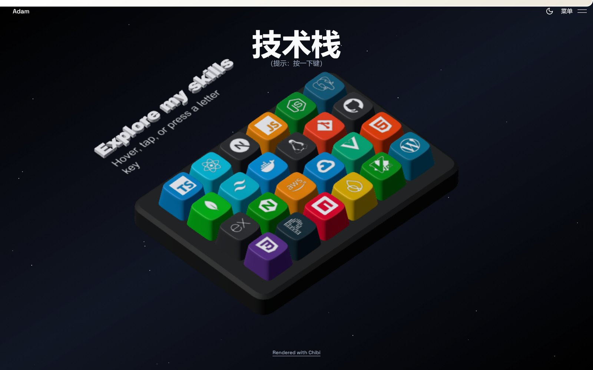
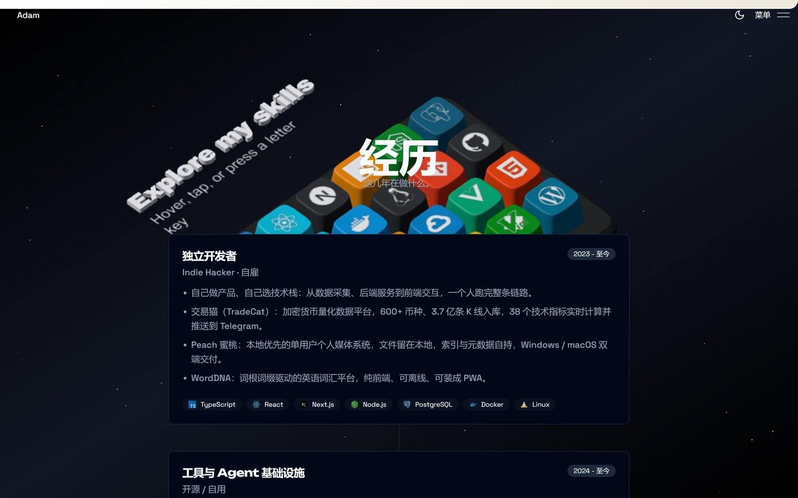
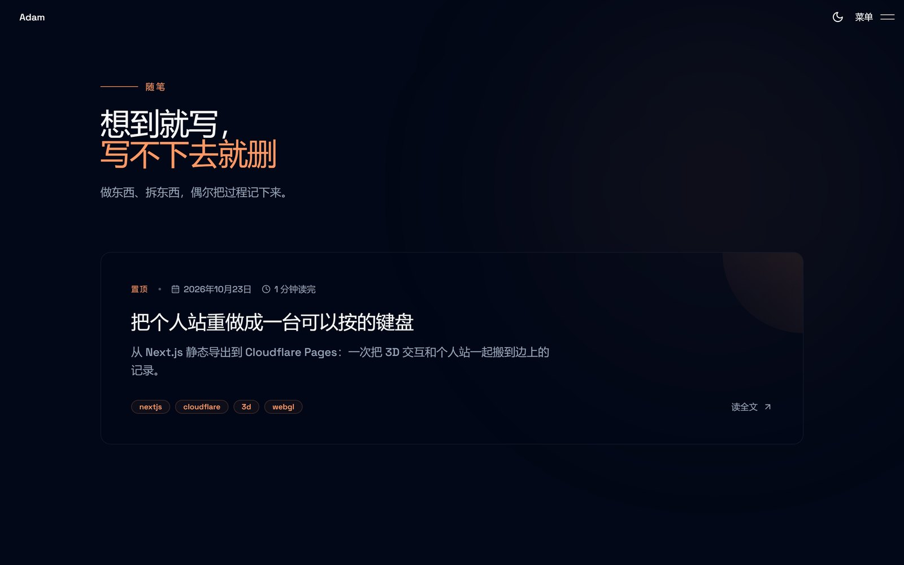
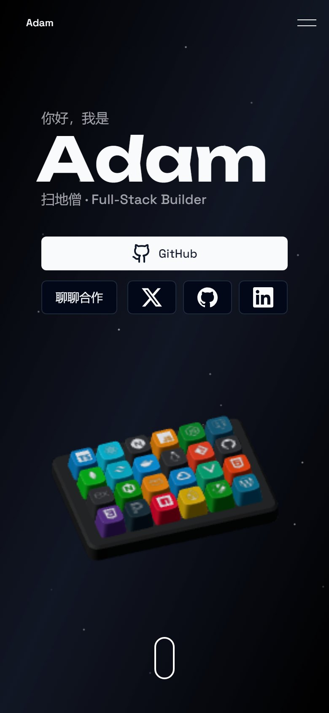

<div align="center">



# Adam · 3D Portfolio

**一台可以按的个人主页。** 24 个键帽组成 3D 键盘，每个键是一项技能；星空粒子、弹性光标、控制台彩蛋，全部静态托管。

<br />

[](https://321.market)
[](https://nextjs.org)
[](https://react.dev)
[](https://www.typescriptlang.org)
[](https://threejs.org)

[](#-部署)
[](#-部署)
[](#-许可与致谢)

[](https://x.com/0xkillcoin)
[](mailto:changyuansex@gmail.com)

</div>

---

## 📸 预览

<div align="center">

**首屏 —— 你好，我是 Adam**

[](https://321.market)

<table>
<tr>
<td width="50%"><a href="https://321.market"></a><br /><sub><b>3D 键盘</b> · 24 个键帽，按下去弹出说明</sub></td>
<td width="50%"><a href="https://321.market"></a><br /><sub><b>项目卡片</b> · 悬停自动滚动的整页截图</sub></td>
</tr>
<tr>
<td width="50%"><a href="https://321.market/blogs/"></a><br /><sub><b>随笔</b> · MDX 驱动，构建时渲染</sub></td>
<td width="50%"><br /><sub><b>移动端</b> · 3D 自动降级为普通网格</sub></td>
</tr>
</table>

</div>

---

## ✨ 特性

### 🎹 一台真的能按的键盘

首页右侧是 WebGL 渲染的 3D 键盘，24 个键帽各自代表一项技能。

- **悬停、点击、按物理键盘**三种触发方式都会让键帽下沉并弹出说明
- 键帽上的图标、塑料配色、按键音效都可单独配置（`src/data/constants.ts`）
- 模型来自 [`@chibi3d/runtime`](https://www.npmjs.com/package/@chibi3d/runtime)，键帽几何以 `.glb` 交付

### 🛰 星空主题

- 全屏 Canvas 粒子，跟随滚动做视差
- 深色为默认，浅色模式带「温馨提示」彩蛋文案
- Lenis 平滑滚动 + GSAP ScrollTrigger 驱动的区块进退场动画

### 📁 项目展示

- 每张卡片是一整页截图的缩略，鼠标悬停时**自动从上滚到下**，离开时平滑回到顶部
- 点开是抽屉式详情页：技术栈图标自带弹性动画、多图轮播、可缩放看图
- 高度自适应：正方形/宽屏截图会以 `cover` 展示，长截图才会滚动，无需逐图配置

### 📝 MDX 随笔

- 文章存在 `src/content/blogs/*.mdx`，frontmatter 用 Zod 校验（`title` / `publishedAt` / `summary` / `tags`）
- 构建时静态渲染，带阅读进度条、阅读时长估算、标签
- 新增文章 = 丢一个 `.mdx` 文件，无需改代码

### ⚡ 为弱设备考虑

- 运行时探测设备性能，动态调整粒子数量、DPR 上限、阴影与后处理
- 没有 WebGL 或开启「减少动态效果」时，3D 键盘自动降级成可读的 HTML 网格
- 所有装饰性动效都可以一键关闭，内容始终可读（`usePerfProfile`）

### 🥚 彩蛋

打开开发者工具看看控制台。不剧透。

---

## 🧱 技术栈

| 层 | 选型 |
| --- | --- |
| **框架** | Next.js 16.2.2（App Router，`output: "export"` 静态导出） |
| **运行时** | React 19.2.4 · TypeScript 5.9 |
| **3D** | Three.js r185 · `@chibi3d/runtime` 0.5.0 |
| **动效** | Motion（Framer Motion）12 · GSAP 3 + ScrollTrigger · Lenis |
| **样式** | Tailwind CSS 3.4 · shadcn/ui 风格组件 · SCSS Modules |
| **内容** | MDX（`next-mdx-remote`）· gray-matter · Zod |
| **字体** | Space Grotesk / Unbounded，**自托管**（构建不依赖 Google Fonts） |
| **托管** | GitHub Pages（自动部署）· 备用 Cloudflare Pages |

**零外部资源依赖**：技能图标、项目截图、卡片壁纸、键盘模型、字体全部放在仓库里。
不依赖任何 CDN，国内网络也能完整加载。

---

## 🚀 本地运行

需要 **Node.js 20.9+** 与 **pnpm 11**（版本由 `package.json` 的 `packageManager` 字段固定）。

```bash
pnpm install
pnpm dev        # http://localhost:3000
```

其他脚本：

```bash
pnpm build      # 静态导出到 out/
pnpm lint       # ESLint
pnpm typecheck  # tsc --noEmit
```

构建产物 `out/` 是纯静态文件，任何静态服务器都能跑：

```bash
npx serve out
```

---

## 🛠 改造成你自己的

所有内容都集中在这几个文件里，不需要动组件：

| 想改什么 | 改哪里 |
| --- | --- |
| 姓名、职位、邮箱、社交链接、站点域名 | `src/data/config.ts` |
| 3D 键盘的 24 个键帽（标签、说明、图标、配色） | `src/data/constants.ts` → `SKILLS` |
| 经历时间线 | `src/data/constants.ts` → `EXPERIENCE` |
| 项目卡片（标题、分类、技术栈、详情正文） | `src/data/projects.tsx` |
| 随笔文章 | `src/content/blogs/*.mdx` |
| 顶部导航 / 页脚链接 | `src/components/header/config.ts`、`src/components/footer/config.ts` |
| 站点标题与社交分享图 | `src/data/config.ts`、`public/assets/seo/og-image.png` |

**项目卡片需要放图**：

```
public/assets/projects-screenshots/<项目 id>/landing.png   # 卡片缩略图（长图会自动滚动）
public/assets/backgrounds/<项目 id>.jpg                    # 卡片壁纸（可选，缺省用渐变）
```

**换键帽图标**：把 SVG 丢进 `public/assets/skill-icons/`，然后在 `SKILLS` 里填 `icon: "/assets/skill-icons/xxx.svg"`。

---

## 📦 部署

仓库自带 GitHub Actions 工作流，**push 到 `main` 就自动构建并发布**。

### GitHub Pages

1. 推到 GitHub 仓库
2. 仓库 **Settings → Pages → Source** 选 **GitHub Actions**
3. 完成后地址是 `https://<用户名>.github.io/<仓库名>/`

如果绑**自定义域名**（本仓库当前就是 `321.market`）：

- 仓库变量 `CUSTOM_DOMAIN` 填域名，工作流会自动写出 `CNAME`
- 或在仓库根目录放一个内容为域名的 `CNAME` 文件
- DNS 需要给 apex 配 4 条 A 记录，指向 GitHub Pages 的 IP：`185.199.108.153` / `185.199.109.153` / `185.199.110.153` / `185.199.111.153`
- `www` 用 CNAME 指向 `<用户名>.github.io`，证书会在 DNS 生效后由 GitHub 自动签发（Let's Encrypt）

### Cloudflare Pages / Vercel

同一份 `out/` 直接能用：

```bash
pnpm build
# Cloudflare Pages
npx wrangler pages deploy out --project-name=<项目名>
# Vercel
npx vercel deploy --prod
```

静态导出没有服务端，所以 `next.config.mjs` 里的 `headers()` / `redirects()` 不生效 ——
安全头写在 `public/_headers`（Cloudflare Pages 识别），Vercel 用 `vercel.json`。

---

## 📂 目录结构

```
src/
├── app/                    # App Router：首页、blogs、404、robots、sitemap
├── components/
│   ├── keyboard/           # 3D 键盘：场景构建、输入、自适应画质、音效
│   ├── sections/           # 首页五个区块
│   ├── ui/                 # shadcn 风格基础组件
│   ├── preloader/          # 首屏加载动画
│   ├── radial-menu/        # 右键环形菜单
│   ├── game/ · realtime/   # 上游模板遗留的多人模块（默认禁用）
│   └── ...
├── content/blogs/          # MDX 文章
├── data/                   # config / constants / projects —— 内容都在这里
├── hooks/                  # usePerfProfile 等
└── lib/                    # MDX 解析、场景健康检查、工具函数
public/
├── assets/keyboard/        # 键帽模型 + 按键音
├── assets/skill-icons/     # 技能图标（自托管）
├── assets/projects-screenshots/  # 项目缩略图
├── assets/backgrounds/     # 项目卡片壁纸
├── assets/seo/             # 社交分享图
└── fonts/                  # 自托管字体
```

---

## 🔧 与上游模板的差异

本仓库改造自 [Naresh-Khatri/3d-portfolio](https://github.com/Naresh-Khatri/3d-portfolio)（MIT），做了以下调整：

| 改动 | 原因 |
| --- | --- |
| `output: "export"` + `trailingSlash` | 纯静态托管，不需要 Node 运行时 |
| 字体自托管（`next/font/local`） | 构建不再访问 Google Fonts，断网也能打包 |
| 移除上游的 `/api/*`、简历页、主机名上报脚本 | 静态导出不支持 API 路由；上报脚本会把访客主机名发到作者服务器 |
| 联系表单改为 `mailto:` | 不依赖邮件服务密钥，也不经手第三方 |
| 图标、壁纸、截图全部本地化 | 上游依赖 jsdelivr CDN，国内大量 403 |
| 界面文案中文，`<html lang="zh-CN">` | —— |
| 保留但默认关闭多人模块 | 需要独立的 WebSocket 服务，见下 |

> **关于游戏与实时聊天**：上游的「Zombie Survival」小游戏、实时光标与聊天室依赖一个独立的
> WebSocket 服务。代码完整保留在 `src/components/game/`、`src/components/realtime/`，
> 但只有设置 `NEXT_PUBLIC_WS_URL` 后入口才会出现。纯静态托管下没有该服务，因此默认隐藏，不影响其他功能。

---

## ❤️ 打赏

如果这个项目对你有帮助，可以请我喝杯咖啡 ☕

<div align="center">


</div>

---

## 📄 许可与致谢

本仓库代码以 **MIT** 许可发布。

界面与交互设计源自 [Naresh Khatri 的 3d-portfolio](https://github.com/Naresh-Khatri/3d-portfolio)，
感谢原作者开源。若你继续分发，请保留上游署名与链接。

技能图标来自 [Devicon](https://devicon.dev/)（MIT），字体 Space Grotesk / Unbounded 来自 Google Fonts（OFL）。

---

<div align="center">

**[🌐 321.market](https://321.market)** · **[𝕏 @0xkillcoin](https://x.com/0xkillcoin)** · **[✉️ 邮件](mailto:changyuansex@gmail.com)**

<sub>用 Next.js + Three.js 做的，静态托管在 GitHub Pages。</sub>

</div>
